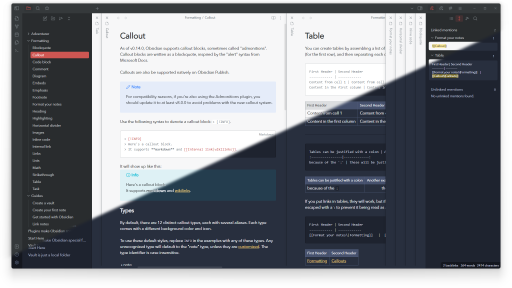

# Red Graphite for Obsidian

> [!IMPORTANT]
> **Red Graphite 2 changes its primary Obsidian appearance from Light to Dark.** This gives Obsidian and sidebar plugins a genuine dark-mode environment, so they receive appropriate dark styling out of the box instead of requiring Red Graphite to maintain custom CSS for every add-on. If you are upgrading from Red Graphite 1.x, open **Settings → Appearance** and set **Base color scheme** to **Dark** after the update. Obsidian will not change this setting for you. Leaving it on Light selects Red Graphite's supported all-light fallback, not its signature mixed appearance.

Red Graphite is a calm, Bear-inspired theme for [Obsidian](https://obsidian.md/). Its default layout uses Obsidian's real dark mode for the graphite application frame and sidebars, then gives the central workspace a light reading surface. Sidebar plugins therefore receive the dark environment they expect without a growing collection of plugin overrides.

Red Graphite 2 requires Obsidian 1.12.7 or newer.

## Install

1. Open **Settings → Appearance**.
2. Next to **Themes**, select **Manage**.
3. Search for **Red Graphite**, select **Install**, then **Use this theme**.
4. Set **Base color scheme** to **Dark**.

### Try the 2.0 development branch

The work-in-progress 2.0 theme is available on [`codex/red-graphite-2`](https://github.com/seanwcom/Red-Graphite-for-Obsidian/tree/codex/red-graphite-2). Desktop, plugin, and physical iOS acceptance is still incomplete; see [the QA record](./docs/QA.md).

1. Download that branch using **Code → Download ZIP**, then extract it.
2. In your work vault, create `.obsidian/themes/Red Graphite/`. If that folder already contains an installed theme, back up its `theme.css` and `manifest.json` first.
3. Copy only the branch's root `theme.css` and `manifest.json` into that folder. No Node installation or build is needed.
4. Reload Obsidian, select **Red Graphite** in **Settings → Appearance**, and set **Base color scheme** to **Dark**.

Keep the branch download outside your vault. The plugin QA installer is for the dedicated test vault and is not needed to use the theme. Repeating the two-file copy updates your development snapshot; it does not update automatically from this branch.

## Choose an appearance

| Obsidian setting | Result |
| --- | --- |
| Dark | Signature graphite frame and sidebars with a light central workspace |
| Dark + **Use a dark central workspace** | Fully dark application |
| Light | Conventional fully light fallback |

The full-dark toggle is available through the [Style Settings plugin](https://github.com/mgmeyers/obsidian-style-settings). The mixed and all-light appearances do not require that plugin.

## Customize Red Graphite

Use Obsidian's **Settings → Appearance → Accent color** control to change the theme-wide accent. This is the canonical global accent and works without Style Settings.

Style Settings adds a grouped **Red Graphite** section for the rest of the design system, including:

- light and dark palettes;
- fonts, type sizes, weights, line heights, and heading treatments;
- document width, margins, spacing, lists, and rules;
- tabs, navigation, status bar, and scrollbars;
- blockquotes, callouts, code, tables, tags, and embeds; and
- light and dark syntax colors plus narrow plugin integrations.

Component colors follow Obsidian's accent by default. Individual overrides can intentionally diverge, and every control can be reset to the shipped default.

## Plugin compatibility

Red Graphite styles Obsidian's semantic variables so third-party views inherit the correct palette when moved between the central workspace and a sidebar. Plugin-specific CSS is reserved for unreadable or unusable behavior that semantic variables cannot solve; cosmetic differences alone are not overridden.

When reporting a compatibility problem, include:

- the Obsidian, Red Graphite, and plugin versions;
- whether the view is in the center or a sidebar;
- the selected Obsidian appearance and whether the full-dark toggle is on; and
- a screenshot plus short reproduction steps.

Use the repository's [GitHub issues](https://github.com/seanwcom/Red-Graphite-for-Obsidian/issues) for reproducible problems.

## Development

Red Graphite is built from Sass, while Obsidian consumes the tracked root `theme.css` and `manifest.json`.

- [Contributing and live development](./CONTRIBUTING.md)
- [Theme architecture](./docs/ARCHITECTURE.md)
- [Desktop, plugin, and iOS QA](./docs/QA.md)
- [Markdown style specimen](./docs/STYLE-SPECIMEN.md)
- [Release procedure](./docs/RELEASING.md)
- [Version history](./CHANGELOG.md)

## License and attribution

The code is released under [The Unlicense](./LICENSE). Red Graphite's visual direction and original color concept are inspired by Bear; credit belongs to Bear's designers for that design language. Red Graphite is an independent Obsidian theme and is not affiliated with Bear.
