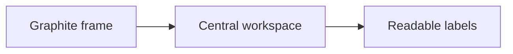

# Red Graphite Style Specimen

Copy this entire file into a disposable note in the visual-test vault. Keep the fixture unchanged while comparing reading, Live Preview, and source modes so the same content exposes regressions between builds. Add a representative case here whenever the theme gains a new Markdown treatment.

This page is a visual stress test for Red Graphite. It includes the Markdown elements most likely to expose problems with hierarchy, rhythm, contrast, alignment, wrapping, and interactive states.

The body type should remain comfortable across a full paragraph. Red Graphite should feel calm and editorial without becoming faint, cramped, or overly formal. A readable line should be easy to follow from beginning to end, while adjacent paragraphs should feel related without running together.

This paragraph contains **bold text**, *italic text*, ***bold italic text***, ~~strikethrough~~, ==highlighted text==, `inline code`, an [external link](https://obsidian.md), a resolved-style [[Internal Link]], an [[Unresolved Note]], #theme-testing, and a nested #design/typography tag.

## Heading hierarchy

The headings below are intentionally close together. Each level should remain recognizable without relying on extreme size changes.

# Heading level one

## Heading level two

### Heading level three

#### Heading level four

##### Heading level five

###### Heading level six

## A long heading that wraps onto another line and tests spacing, weight, line height, and hierarchy

The wrapped heading should stay cohesive. Its second line should not collide with the paragraph below it or look like a separate heading.

## Paragraph rhythm

Typography is the interface between an idea and the person reading it. Good theme typography should largely disappear during sustained reading while still making structure obvious when the reader scans the page.

Short paragraphs need enough separation to breathe.

Longer paragraphs need a comfortable line height and a restrained line width. This sentence adds enough material to reveal whether the text becomes tiring, whether punctuation remains crisp, and whether the right edge of the text block feels balanced against the surrounding workspace.

---

## Unordered lists

- First-level item
- Another first-level item with enough text to wrap onto a second line so that hanging indentation and line spacing can be evaluated clearly
  - Second-level item
  - Second-level item with **bold text** and an [[Internal Link]]
    - Third-level item
    - Another third-level item
- Final first-level item

### Compact unordered list

- Alpha
- Beta
- Gamma
- Delta

## Numbered lists

1. First numbered item
2. Second numbered item with enough text to wrap onto another line so that the number gutter and continuation indentation can be evaluated
   1. Nested numbered item
   2. Another nested numbered item
      1. Third-level numbered item
3. Final numbered item

### Numbered list with nested bullets

1. Research the problem.
   - Record the current behavior.
   - Capture a screenshot.
2. Make one focused change.
   - Test light document mode.
   - Test the full-dark toggle.
3. Compare the result.

## Task lists

- [ ] Unchecked task
- [x] Completed task
- [ ] Task with a longer description that wraps and reveals checkbox alignment across multiple lines
  - [ ] Nested unchecked task
  - [x] Nested completed task
- [ ] Task containing an [external link](https://help.obsidian.md)

Completed checkboxes use a neutral fill and a readable checkmark in all three appearance states. Check hover and keyboard focus as well as the static task states.

---

## Quotes and blockquotes

> A simple quotation should feel distinct from body text without becoming a heavy container. The accent should support the quotation rather than dominate it.

> A blockquote can contain multiple paragraphs.
>
> The spacing between quoted paragraphs should remain clear, and both paragraphs should share the same visual structure.

> A first-level quotation
>
> > A nested quotation adds another level of context.
> >
> > > A third level should remain readable, even if it is uncommon.

> **Quoted heading**
>
> Quotes may contain **bold text**, *emphasis*, `inline code`, and [links](https://obsidian.md).

## Callouts

> [!note] Note callout
> A standard callout with enough content to wrap onto a second line. Its title, icon, border, and background should belong to the same visual system.

> [!tip] Tip callout
> Use semantic color carefully. The content should remain readable without depending only on hue.

> [!warning] Warning callout
> Warning states need emphasis, but they should not overwhelm the document.

> [!danger] Danger callout
> Critical information should be immediately recognizable.

> [!quote] Quote callout
> “Design is the silent ambassador of your intent.”

> [!example]- Collapsed callout
> This content is visible after expanding the callout.

> [!abstract]+ Expanded foldable callout
> This callout starts expanded and tests the fold indicator.

---

## Tables

| Element | Purpose | Expected treatment |
| :--- | :---: | ---: |
| Header | Establish hierarchy | Medium emphasis |
| Body cell | Present ordinary data | Calm and readable |
| Link | Provide navigation | [Obsidian](https://obsidian.md) |
| Numeric value | Test alignment | 1,234.56 |
| Inline code | Show a token | `theme.css` |

### Wide and wrapping table

| Setting | Default | Description | Status |
| --- | --- | --- | --- |
| Frame base | Graphite | Controls the application frame, sidebars, ribbon, and global chrome | Stable |
| Document base | White | Controls the central workspace in flagship mode | Stable |
| Accent | Red | Identifies selections, links, and important interactive states | Review |
| Typography | Interface and text fonts | This intentionally long description should wrap without making the row difficult to scan | Review |

---

## Code

Inline code should sit naturally within a sentence: `npm run dev` rebuilds and deploys the theme.

```javascript
const theme = {
  name: "Red Graphite",
  mode: "mixed",
  accent: "#cb4c48",
};

function describeTheme({ name, mode }) {
  return `${name} uses a ${mode} workspace.`;
}
```

```css
body.theme-dark {
  --background-primary: #292c2e;
  --interactive-accent: #cb4c48;
}
```

```text
Plain text blocks should remain legible without syntax highlighting.
Long lines should scroll or wrap according to Obsidian's normal behavior.
```

## Mermaid diagrams

The diagram should stay readable on the light central workspace in flagship Dark mode and in the conventional Light appearance. Check it again with the dark central workspace enabled.



## Mathematics

Inline mathematics should align with the surrounding text: $E = mc^2$.

$$
\operatorname{contrast}(L_1, L_2) = \frac{L_1 + 0.05}{L_2 + 0.05}
$$

## Footnotes

Red Graphite is inspired by Bear while being designed for Obsidian.[^1] A second footnote tests spacing between references.[^details]

[^1]: Bear is a notes application with a distinctive graphite-and-paper visual language.
[^details]: Footnotes should be quieter than body text while remaining fully readable.

## Embeds and media placeholders

> [!info] Optional embed test
> Replace the filenames below with real notes or media from the test vault.

```markdown
![[Existing Note]]
![[Existing Image.png]]
![[Existing PDF.pdf#page=1]]
```

## HTML details

<details>
<summary>Expandable details section</summary>

Content inside a native details element should use the same document palette and typography as the rest of the note.

</details>

---

## Mixed-content stress test

1. **Planning**
   - Review the [[Theme Test Page]].
   - Record visual issues in `docs/QA.md`.
   - [ ] Check the desktop layout.
2. **Implementation**
   > [!tip] Keep changes semantic
   > Prefer Obsidian variables over plugin-specific selectors.
3. **Verification**

   | Check | Result |
   | --- | --- |
   | Build | `npm run build` |
   | Tests | `npm test` |
   | Consistency | `npm run check` |

## Visual QA checklist

- [ ] Inline title and H1 are clearly different.
- [ ] H1 through H6 form an obvious but restrained hierarchy.
- [ ] Paragraph width and line height are comfortable.
- [ ] Bold text is emphasized without becoming heavy.
- [ ] Links and tags are recognizable but not distracting.
- [ ] Bullet and number indentation remains aligned at every level.
- [ ] Task checkboxes align with wrapped text.
- [ ] Quotes and callouts feel related but distinct.
- [ ] Horizontal rules separate sections without becoming dominant.
- [ ] Table headers, rows, borders, and alignment remain readable.
- [ ] Inline and fenced code belong to the document palette.
- [ ] The active tab is immediately identifiable.
- [ ] Moving a plugin view between the center and sidebar preserves usability.

%% This comment should be hidden in reading view and visible in source mode. %%
